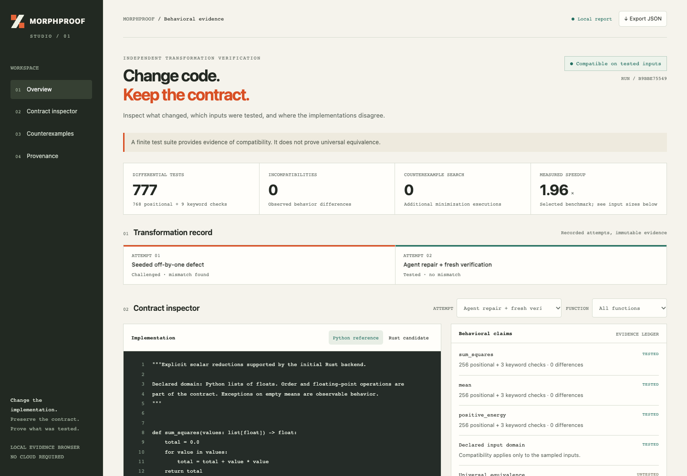
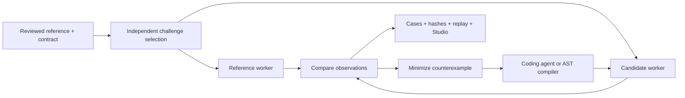
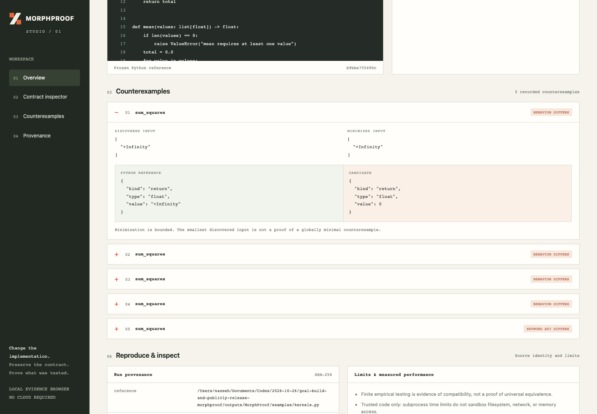

<p align="left"></p>

# Change the implementation. Preserve the contract.

**Independent behavioral evidence for Python-to-Rust transformations.**

MORPHPROOF compiles a declared subset of numerical Python into an installable
Rust-backed Python package, challenges both implementations in separate processes,
and turns disagreements into small, replayable counterexamples. Studio shows what
passed, what failed, and what remains untested.

[](https://github.com/nazeeh111/MorphProof/actions/workflows/ci.yml)
[](LICENSE)
[Release](https://github.com/nazeeh111/MorphProof/releases/latest) ·
[Technical report](docs/technical-report.md) · [Research](docs/research.md) ·
[Agent integrations](docs/integrations.md)



## A small, complete workflow

```sh
git clone https://github.com/nazeeh111/MorphProof.git
cd MorphProof
python -m venv .venv
source .venv/bin/activate             # Windows: .venv\Scripts\activate
python -m pip install -e .
# Install the free Rust toolchain if needed: https://rustup.rs/
morphproof transform examples/kernels.py --contract examples/contract.json -o runs/native
morphproof studio runs/native/evidence --serve
```

Open the loopback URL printed by Studio. The transformation command generates the
Rust crate and Python wrapper, compiles the native extension, runs independent
verification, and exports the evidence. Exit status is `0` for sampled
compatibility, `1` for a mismatch/incomplete verification, and `2` for invalid
input or a build failure. Choose a fresh output directory for each run.

Requires Python 3.10+; compilation requires Rust and a native linker. The repository
pins Rust 1.99.1 and generated crates pin PyO3 0.27.2. First compilation downloads
open-source crates; later cached builds can run offline. Verification and Studio
have **no third-party runtime dependencies** and need neither Rust nor a model.
This is an alpha release with an explicit, intentionally narrow contract.

## What is supported

- Pure, deterministic functions with one `list[float]` parameter and a float result.
- Float accumulators, ordered loops, constant slices/indexes, arithmetic, comparisons,
  `if`, `len`, `abs`, and literal supported exceptions. Other syntax is rejected.
- Declared function and parameter names, ordered binary64 operations, exception
  type/message, signed zero, infinity and NaN class. Exact comparison is the default.
- A generated mixed Python/Rust package that preserves the reference module's import
  name and declared keyword names. No silent Python fallback.

[The contract specification](docs/contracts.md) defines the boundaries, budgets,
timeouts and unsupported behavior. Arbitrary repositories, NumPy objects, integers,
stateful code and universal equivalence are outside the compiler's claims.
Only execute trusted code: process separation is **not a security sandbox**.

## Inspect, challenge, repair, deliver

```sh
morphproof inspect path/to/repository -o inventory.json
morphproof discover path/to/kernel.py -o contract.json  # review the proposed domain
morphproof verify original.py candidate.py --contract contract.json -o runs/check
morphproof verify original.py candidate.py --contract contract.json -o runs/adaptive --strategy adaptive
```

Repository inspection inventories public signatures, docstrings, existing tests,
documentation and dependency manifests without executing code. Discovery proposes
a bounded contract; it does not infer a universal behavioral specification.

Each campaign retains original/candidate snapshots, source and declared native
artifact hashes, every tested input/outcome, minimized counterexamples, a replay
script and a portable HTML Studio report. Build the generated package with Maturin
when you are ready to distribute it:

```sh
python -m pip install '.[build]'
maturin build --release --manifest-path runs/native/Cargo.toml -o runs/wheels
# Install the resulting platform wheel into the target environment.
```

Codex, Claude Code or another coding agent can generate and repair candidates
through a [file-based handoff](docs/integrations.md). The bounded compiler is
deterministic; AI is optional and uses your existing agent. MORPHPROOF has no model
API client and does not handle credentials. The generator receives failures while
the reference, domain and acceptance logic stay outside its candidate task.



## The actual demonstration

The [retained run](examples/demo/README.md) transforms three numerical reductions.
A **disclosed seeded off-by-one defect** skips the first item of `sum_squares`.
The verifier finds a mismatch and reduces a finite example to `[1.0]`.
An actual invocation of the installed Codex CLI removes `.skip(1)`. MORPHPROOF then
rebuilds independently, replays the failures, and passes **768 fresh positional
comparisons plus 9 keyword API checks** with a different seed.

The final `sum_squares` Python API is **1.96× faster at 100,000 items** in this local
run, including argument conversion. Small calls can be slower: `positive_energy`
at 16 items measured **0.95×**. [All raw timings](examples/demo/benchmark.json),
[initial Rust](examples/demo/initial.rs), [repair patch](examples/demo/repair.patch),
and [agent case study](examples/demo/agent-repair.md) are retained. This is one
seeded repair demonstration, not a measured rate of autonomous migration success.

[Watch the 27-second evidence walkthrough](https://github.com/nazeeh111/MorphProof/releases/download/v0.1.0/morphproof-demo.mp4)



Reproduce the seeded defect and deterministic restoration without a model:

```sh
python experiments/reproduce_demo.py -o runs/demo
```

## Adaptive testing: measured, experimental

The original experimental selector combines AST hazards, input feature novelty,
and feedback from reference coverage/outcomes. Candidate outputs never influence
selection. The study compares it with ordinary cases, fixed boundaries, uniform
fuzzing, random structured inputs, random selection from the same pool, Hypothesis,
and an ablation removing reference feedback.

**The results do not establish an adaptive advantage.** At 128 calls, adaptive
selection detects 66/75 synthetic defect-seed trials; same-pool random finds 69/75.
On two independently selected upstream functions, fixed boundaries detect both
naive-fold incompatibilities across seeds; adaptive detects one. Boundary testing
is therefore the release default and adaptive mode remains experimental.
No learned selector is justified by these results.


The study includes 15 authored behavioral differences, one unchanged control,
five seeds, three budgets and two pinned upstream sources with licenses. These
small samples do not establish general migration effectiveness. See the
[technical report](docs/technical-report.md) for denominators, runtime, ablations,
limitations and exact reproduction commands. No aggregate coding-agent baseline
or formal proof is claimed.

## Python API

```python
import json
from pathlib import Path
from morphproof import transform, verify

contract = json.loads(Path("examples/contract.json").read_text())
artifact = transform(Path("examples/kernels.py"), Path("runs/api"), contract)
report = verify(Path("examples/kernels.py"), Path(artifact["candidate"]),
                contract, Path("runs/api/evidence"), budget=128)
assert report["status"] == "compatible"  # only the recorded domain/cases
```

## Development and evidence

```sh
python -m pip install -e '.[test]'
python -m pytest -q
```

CI covers the Python suite and native smoke transformations. Check the live
workflow for platform-specific results. [Contributions](CONTRIBUTING.md) that add
small compatibility regressions, independently selected migration cases or better
selectors with honest held-out measurements are especially useful.

[MIT license](LICENSE). [Dependency and upstream attribution](docs/THIRD_PARTY.md).
Finite tests are evidence of compatibility, never a mathematical proof of universal
equivalence. Prove what was actually tested.
