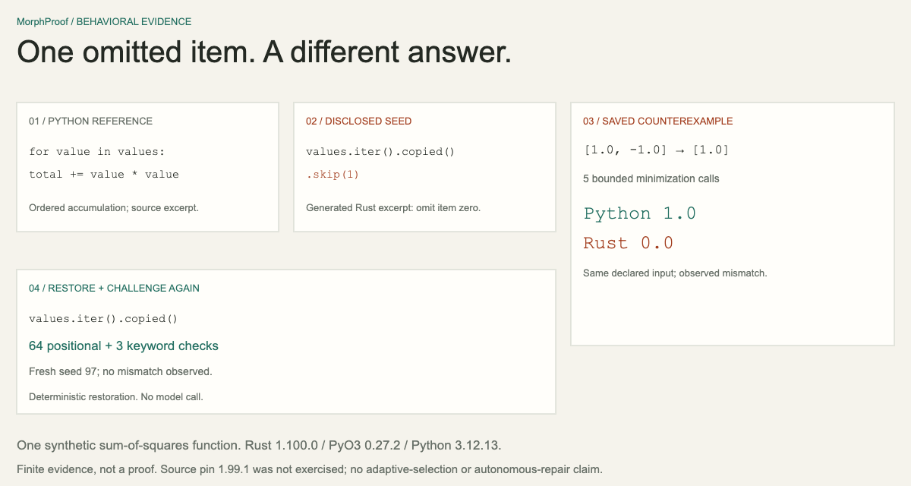

<p align="left"></p>

# Change the implementation. Preserve the contract.

**Compile supported numerical Python to Rust. Keep the behavioral evidence.**

MorphProof builds a Rust-backed Python package, challenges reference and candidate in separate processes, and reduces disagreements to small, replayable counterexamples. Its portable Studio shows the source, tested inputs, observed differences and claims that remain untested.

[](https://github.com/nazeeh111/MorphProof/actions/workflows/ci.yml)
[](LICENSE)

<picture>
  <source media="(max-width: 600px)" srcset="docs/presentation/witness-mobile.png">
  
</picture>

In this recorded one-function case, a deliberately faulty Rust loop skips the first item. `[1.0]` exposes the difference: Python returns **1.0**, Rust **0.0**. Restoring the generated loop passes 64 fresh positional comparisons and 3 keyword checks. The restoration is deterministic, not autonomous.

[Inspect the complete case and limits](docs/presentation/README.md) · [Download the worked artifact](docs/presentation/worked-example.zip)

## A small, complete workflow

Use Python 3.10+. Native compilation also needs Rust 1.99.1 and a native linker; generated crates pin PyO3 0.27.2. First compilation downloads open-source crates. No model or API key is required.

```sh
git clone https://github.com/nazeeh111/MorphProof.git
cd MorphProof
python -m venv .venv
source .venv/bin/activate             # Windows: .venv\Scripts\activate
python -m pip install -e .
morphproof transform examples/kernels.py --contract examples/contract.json -o runs/native
morphproof studio runs/native/evidence --serve
```

Open the printed loopback URL. Choose a fresh output directory for each run. Exit `0` means compatible on sampled inputs, `1` means a mismatch or incomplete verification, and `2` means invalid input or a build failure.

For a recorded example without compilation, extract the worked artifact and open `repaired/studio.html`. Its native replay requires macOS ARM64 and Python 3.12; the browser viewer is portable. The original native case used Rust 1.100.0, distinct from the repository's unchanged 1.99.1 pin.

## What is supported

- Pure, deterministic functions with one `list[float]` parameter and a float result.
- Ordered loops, float accumulators, constant slices/indexes, arithmetic, comparisons, `if`, `len`, `abs` and supported literal exceptions. Unsupported syntax is rejected.
- Declared import and keyword names, binary64 operation order, exception type/message, signed zero, infinity and NaN class. Exact comparison is the default.

[The contract specification](docs/contracts.md) defines the domain and budgets. NumPy objects, stateful code, arbitrary repositories and universal equivalence are outside the compiler's claims. Execute trusted source only: worker separation is **not a security sandbox**.

## Inspect, challenge, repair, deliver

```sh
morphproof inspect path/to/repository -o inventory.json
morphproof discover path/to/kernel.py -o contract.json
morphproof verify original.py candidate.py --contract contract.json -o runs/check
```

Review discovered contracts before use. Campaigns retain snapshots, hashes, tested observations, minimized counterexamples and replay scripts. Studio switches between recorded attempts and Python/Rust source, filters functions and exports the selected report.


## Development and evidence

```sh
python -m pip install -e '.[test]'
python -m pytest -q
```

The current local suite passes 37 tests and 12 subtests. Studio's repaired section navigation, keyboard tabs, report download and responsive views were exercised in Chromium, Firefox and WebKit. [Verification and limits](docs/current-studio/VERIFICATION.md) distinguish current checks, recorded native replay and fresh native compilation.

<a id="the-actual-demonstration"></a>
<a id="adaptive-testing-measured-experimental"></a>
<a id="python-api"></a>
The [complete guide](TECHNICAL_GUIDE.md) preserves the Python API, package delivery commands, historical three-function repair and measured selector study. That study does **not** establish an adaptive advantage; boundary testing remains the default. Historical benchmark results are not new performance measurements.

[Technical report](docs/technical-report.md) · [Research](docs/research.md) · [Agent integrations](docs/integrations.md) · [Original release](https://github.com/nazeeh111/MorphProof/releases/latest) · [Contributing](CONTRIBUTING.md) · [MIT license](LICENSE) · [Third-party notices](docs/THIRD_PARTY.md)
