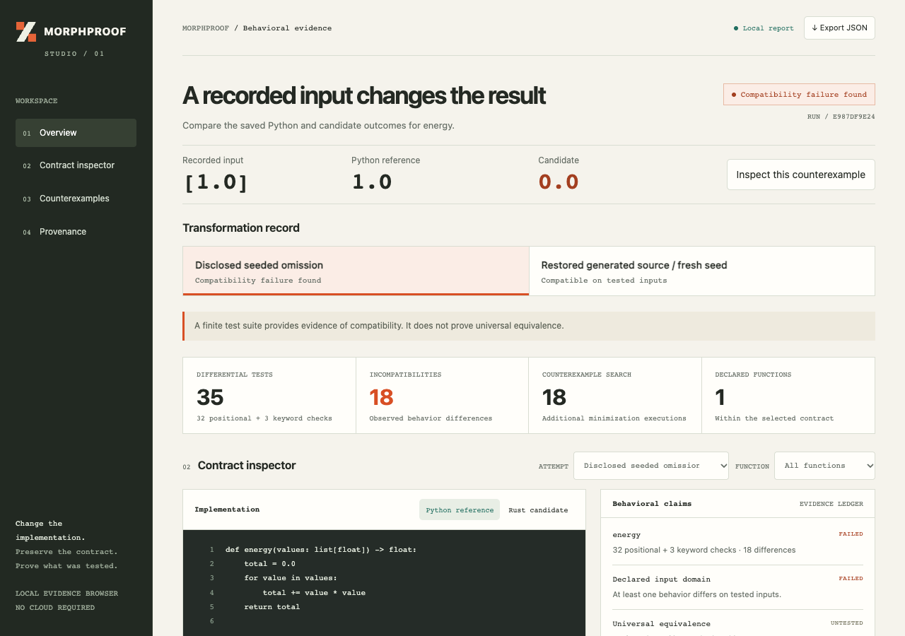
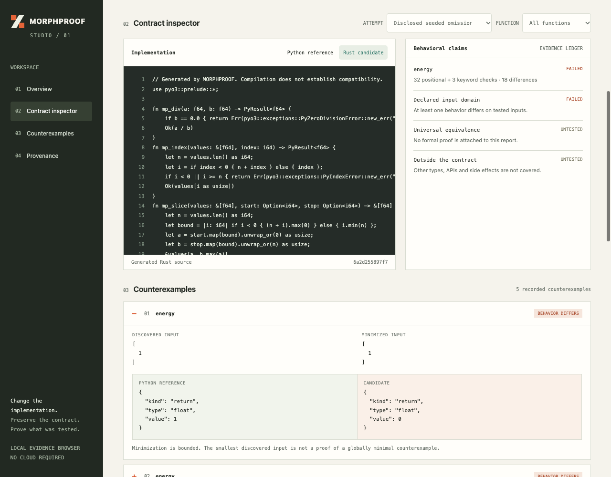

# MorphProof

A deliberately seeded Rust loop skips its first item. On the recorded input `[1.0]`, Python returns **1.0** and the Rust candidate returns **0.0**. Restoring the generated loop passes 64 fresh positional comparisons and 3 keyword checks. Those finite checks leave other inputs untested.

[Inspect the recorded case](docs/presentation/README.md) · [Download the complete worked-example ZIP](https://raw.githubusercontent.com/nazeeh111/MorphProof/131f4aee72c32653d849a8f6c2462a522fa86537/docs/presentation/worked-example.zip) · [Run the workflow](#a-small-complete-workflow)

MorphProof compiles supported numerical Python to Rust and compares the reference and candidate in separate processes. Studio opens the recorded disagreement when one is available and lets you select the restored attempt, inspect the source and export either report. The recorded repair restored the generated source deterministically.

<picture>
  <source media="(max-width: 600px)" srcset="docs/current-studio/witness-390.png">
  
</picture>

## A small, complete workflow

Use Python 3.10+. Native compilation also needs Rust 1.99.1 and a native linker; generated crates pin PyO3 0.27.2. First compilation downloads open-source crates. No model or API key is required.

```sh
git clone https://github.com/nazeeh111/MorphProof.git
cd MorphProof
python -m venv .venv
source .venv/bin/activate             # Windows: .venv\Scripts\activate
python -m pip install -e .
morphproof transform examples/kernels.py --contract examples/contract.json -o runs/native
morphproof studio runs/native/evidence --serve
```

Open the printed loopback URL. Choose a fresh output directory for each run. Exit `0` means compatible on sampled inputs, `1` means a mismatch or incomplete verification, and `2` means invalid input or a build failure.

Native builds resolve the Cargo lockfile before locked compilation, use an owned target directory, and select the library reported by Cargo. Builds of the same candidate cannot run simultaneously. For caught build or publication failures, MorphProof attempts to preserve the previous native file and invalidates its build receipt; retry after correcting the failure. If native restoration fails, the error names the retained backup. Input changes during compilation cause a refusal. These checks assume cooperating local writers; they do not cover power loss or hostile filesystem changes.

For a recorded example without compilation, extract the worked artifact and open `repaired/studio.html`. Its native replay requires macOS ARM64 and Python 3.12. The archived browser viewer is portable. To render the same reports with the current Studio, run `morphproof studio repaired` from the extracted directory. The original native case used Rust 1.100.0, distinct from the repository's unchanged 1.99.1 pin.

## What is supported

- Pure, deterministic functions with one `list[float]` parameter and a float result.
- Ordered loops, float accumulators, constant slices/indexes, arithmetic, comparisons, `if`, `len`, `abs` and supported literal exceptions. Unsupported syntax is rejected.
- Declared import and keyword names, binary64 operation order, exception type/message, signed zero, infinity and NaN class. Exact comparison is the default.

[The contract specification](docs/contracts.md) defines the domain and budgets. NumPy objects, stateful code, arbitrary repositories and universal equivalence are outside the compiler's claims. Execute trusted source only: worker separation is **not a security sandbox**.

## Inspect, challenge, repair, deliver

```sh
morphproof inspect path/to/repository -o inventory.json
morphproof discover path/to/kernel.py -o contract.json
morphproof verify original.py candidate.py --contract contract.json -o runs/check
```

Review discovered contracts before use. Campaigns retain snapshots, hashes, tested observations, minimized counterexamples and replay scripts. Studio switches between recorded attempts and Python/Rust source, filters functions and exports the selected report.



## Development and evidence

```sh
python -m pip install -e '.[test]'
python -m pytest -q
```

Studio supports keyboard attempt selection, source tabs and report downloads. [Current failure and restored captures](docs/current-studio/CAPTURES.md) come from the original recorded reports. [Verification and limits](docs/current-studio/VERIFICATION.md) distinguish current checks, recorded native replay and fresh native compilation.

<a id="the-actual-demonstration"></a>
<a id="adaptive-testing-measured-experimental"></a>
<a id="python-api"></a>
The [complete guide](TECHNICAL_GUIDE.md) preserves the Python API, package delivery commands, historical three-function repair and measured selector study. That study does **not** establish an adaptive advantage; boundary testing remains the default. Historical benchmark results are not new performance measurements.

[Technical report](docs/technical-report.md) · [Research](docs/research.md) · [Agent integrations](docs/integrations.md) · [Original release](https://github.com/nazeeh111/MorphProof/releases/latest) · [Contributing](CONTRIBUTING.md) · [MIT license](LICENSE) · [Third-party notices](docs/THIRD_PARTY.md)
