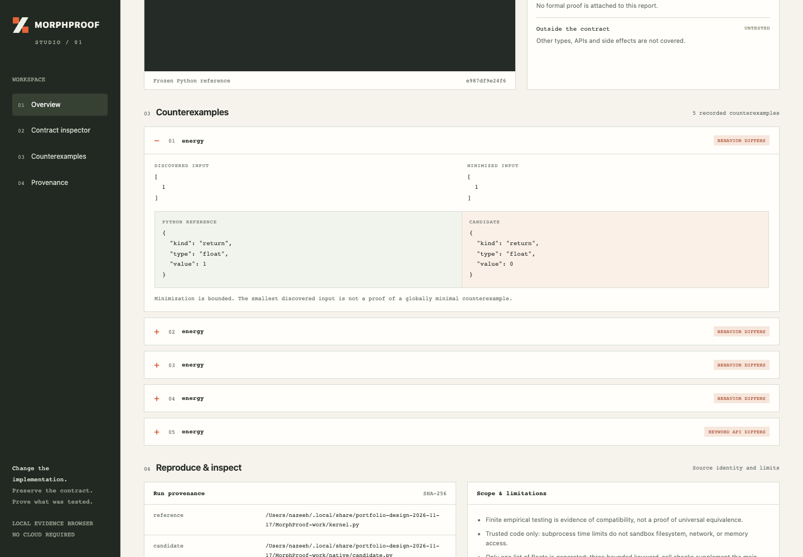

# One omitted item changes the answer

Original synthetic case executed on source `80a0daaf3eec332642159971ac33b8c59e3d0eaf`. The original historical three-function demonstration and its benchmark/study remain separate. This new case makes no performance, adaptive-selection, autonomous repair or universal-equivalence claim.

[Python](kernel.py) computes an ordered sum of squares. The [reviewed contract](contract.json) admits one `list[float]` parameter named `values`, a float result and maximum generated length 32, with exact comparisons. That length is a test-generation bound, not a runtime guard. Signed zero, infinity, NaN class and declared keyword behavior follow the current verifier; NaN payloads, timing, side effects and arbitrary objects do not.

The generated [initial Rust](initial.rs) has a deliberately inserted `.skip(1)`. On `[1.0, -1.0]`, Python returns 2.0 and the candidate returns 1.0. Five bounded minimization calls retain `[1.0]`, producing 1.0 versus 0.0. This is one discovered small witness, not proof of a globally minimal input. The initial campaign made 32 positional comparisons with 17 differences, plus 3 keyword checks with 1 difference. Those counts are not unique-input counts.

Restoring the unmodified generated loop in [repaired.rs](repaired.rs) and rebuilding gives 64 fresh positional comparisons and 3 keyword checks at seed 97 with no difference observed. Both campaigns contain 27 unique positional inputs, recorded separately from comparison budgets. Every saved failure replays against the restored native candidate. The restoration is deterministic and uses no model or coding agent.

## Reopen actual evidence

[Download worked-example.zip](https://raw.githubusercontent.com/nazeeh111/MorphProof/131f4aee72c32653d849a8f6c2462a522fa86537/docs/presentation/worked-example.zip), extract to a fresh directory and run `python3.12 -I -B reopen.py`. This includes the dependency-free MorphProof replay engine, exact original native artifact snapshots for both attempts, source/contract/case records, Studio, the built wheel and retained notices. All paths named by MANIFEST.json are included and hash-checked before native replay. Only this known-source synthetic native code executes. Recorded native wrappers require macOS ARM64 with Python 3.12; other platforms should rebuild from the supplied source with their own explicit toolchain.

Both native snapshots match every original per-run declared artifact hash. Absolute paths embedded in the original reports identify the execution locations; they are provenance, not bundle dependencies. Fresh replay uses bundled relative paths. A new compiler build or wheel can legitimately have a different binary hash; this bundle does not relabel it as the original artifact.

The wheel `kernel_morphproof-0.1.0-cp310-abi3-macosx_11_0_arm64.whl` was built by Maturin 1.16.0 and installed into a fresh Python 3.12 environment. Positional `[3.0, 4.0]` returned 25.0, keyword `[1.0]` returned 1.0, and NaN/infinity classes were retained. The abi3 tag is packaging metadata, not a test of every admitted interpreter/platform. Keep LICENSE.txt, DEPENDENCIES.md and the actual Cargo dependency notices with the worked package.

**Actual toolchain:** Rust/cargo 1.100.0, PyO3 0.27.2, Python 3.12.13. The repository's declared Rust 1.99.1 pin is unchanged and was not exercised here. Maturin completed the wheel build with warnings, including unavailable rust-objcopy/libLLVM support; the delivered wheel imported and executed successfully. No toolchain identity check or refusal was weakened.

## Inspect Studio

Open `repaired/studio.html` for the archived viewer. To generate the current Studio from the original reports, run `morphproof studio repaired` in the extracted copy. It opens the recorded positional mismatch when available. Use the attempt buttons to compare the restoration and **Inspect this counterexample** to go directly to the saved details. It is a portable recorded evidence viewer, not an editor that runs a transformation or accepts uploaded code. Select the seeded/restored attempt, switch Python/Rust with keyboard arrow keys, inspect counterexamples and export the selected report. The actual browser exported report equals the failed report exactly; a fresh local opening retains the recorded attempts. Universal equivalence and outside-contract behavior stay explicitly untested.

<picture>
  <source media="(max-width: 600px)" srcset="studio-mobile.png">
  
</picture>

[Desktop mechanism SVG](witness.svg) · [phone SVG](witness-mobile.svg) · [generator](figure.py) · [complete hashes](figure-manifest.json). Code is explicitly excerpted from actual source; values and counts come from the stored reports. It is a mechanism diagram, not a measured statistical chart. Title and description are natural prose with separate words and numbers.

Current CLI also refused unsupported `sum(values)` syntax before creating an output, refused an existing native destination without changing its files, and preserved prior Studio HTML when given a malformed report. Studio has no transformation cancellation control; no running-job cancellation or sandbox claim follows. Workers isolate process state/time, not filesystem access. Only execute trusted source.

No new product defect was demonstrated in this bounded journey, so expert controls, CLI/API responses and held branches remain unchanged. Existing full development tests passed in this core environment; optional Rust-pin/platform validation, timing experiments, model calls and the prior selector study were not rerun.
