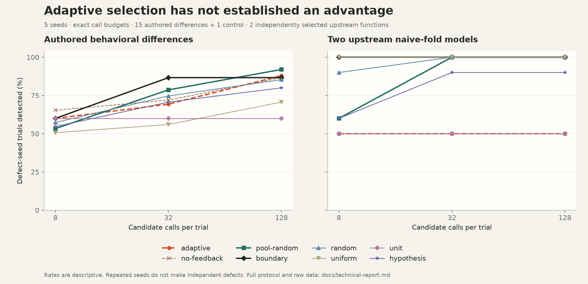

# MORPHPROOF 0.1 technical report

Measured on 2026-10-26. This is a bounded engineering prototype and a small selector study, not evidence of universal equivalence or general autonomous migration success.

## Main findings

- A real Python-to-Rust transformation, disclosed seeded off-by-one failure, actual coding-agent repair, independent rebuild and fresh verification are retained.
- The repaired run passed 768 positional comparisons plus 9 keyword API checks and saved-counterexample replay.
- The selected 100,000-item `sum_squares` public API measured 1.96x faster locally, including Rust argument extraction. Some small inputs were slower.
- The adaptive heuristic did not consistently improve detection. Fixed boundary testing is the release default. No learned selector is justified.

## Implementation and independence

The compiler lowers a restricted Python AST into ordered binary64 Rust operations through pinned PyO3 0.27.2. Explicit helpers preserve zero-division and index errors; Python wrappers preserve declared keyword names. Generated mixed packages are built by Maturin. Unsupported syntax fails before output generation. There is no hidden Python fallback.

Verification lives in a separate implementation and interpreter pair. It snapshots the module bytes, hashes the declared contract and listed native artifacts, generates challenges without candidate-output feedback, compares return types, numerical observations and exception type/message, and stores every challenge. Reference source lines/arcs and outcome classes drive the experimental policy. Minimization has a separate cap and cannot consume discovery budget. Immutable here means checked bytes for the run, not protection against a malicious process with the same privileges.

Missing/noncallable APIs, invalid reference types/keyword contracts, timeouts, serialization failures and source changes invalidate acceptance. Matching subject exceptions are still observable behavior. Imports and unlisted dependencies are not frozen. Read [contracts.md](contracts.md) and [SECURITY.md](../SECURITY.md).

## Selector experiment protocol

Development examples are three numeric reductions. The evaluation source is a different conditional reduction with 15 authored mutations and one unchanged control. The selector does see reference source, but never candidate code or outcomes when choosing inputs. Mutations cover empty behavior, error text, boundaries, arithmetic/order, precision, nonfinite values, signed zero and length-specific differences. These are known synthetic differences, not an independently sampled real-defect corpus.

A separate research task selected two upstream projects by numerical API relevance: boltons mean and more-itertools sum_of_squares. Original files, immutable revisions, SHA-256 hashes, licenses and thin wrappers are in [upstream/](../experiments/upstream/README.md). Candidates for this part are deliberately naive Python fold models of a common Rust lowering. They are not compiled Rust migrations or full-package transformations. The more-itertools function may return integer zero on empty input; its actual observation is preserved in the study.

Five seeds and budgets of 8, 32 and 128 candidate calls are used. Each call is paired with one reference execution. All methods use their exact configured budget in this run, including Hypothesis. No study shrinking is performed. The eight methods are:

- **Adaptive:** static source hazards, novel input features and diminishing reference coverage/outcome rewards.
- **No feedback:** same heuristic/pool without reference outcome or coverage updates; input novelty and static hazards remain.
- **Same-pool random:** randomly removes candidates from the exact same seeded pool, including boundaries.
- **Boundary:** fixed edge cases with source constants; repeats once exhausted.
- **Structured random:** samples the same input-family generator without adaptive prioritization.
- **Uniform:** random lengths and values uniformly drawn from [-100,100].
- **Unit:** six ordinary/empty/threshold cases repeated to use the call budget; repetition adds no new information.
- **Hypothesis:** native binary64 lists, including nonfinite values, generate phase only, no database or shrinking.

The frozen selector bytes used by the running experiment are [selector-v1.py](../experiments/selector-v1.py), SHA-256 `78255c36c1d50e797c81a269c98920a581e5e90ada394498cd68cb6ead04101d`. A subsequent finite-only-domain safeguard in the shipping selector excludes overflowed threshold neighbors when nonfinite values are forbidden; the study used the default nonfinite-allowed domain, whose selection behavior is unchanged. No policy tuning followed these results. The supplemental same-pool baseline uses the same frozen selector.

## Synthetic detection results

Each cell counts detected defect-seed trials out of 75 (15 differences x 5 seeds). A trial counts once regardless of how many input mismatches it produces. Seeds for a shared fixture are not statistically independent defects; rates are descriptive and no population confidence claim is made.

| Method | 8 calls | 32 calls | 128 calls |
|---|---:|---:|---:|
| adaptive | 45/75 (60.0%) | 52/75 (69.3%) | 66/75 (88.0%) |
| no-feedback | 49/75 (65.3%) | 54/75 (72.0%) | 65/75 (86.7%) |
| pool-random | 40/75 (53.3%) | 59/75 (78.7%) | 69/75 (92.0%) |
| boundary | 45/75 (60.0%) | 65/75 (86.7%) | 65/75 (86.7%) |
| random | 43/75 (57.3%) | 56/75 (74.7%) | 64/75 (85.3%) |
| uniform | 38/75 (50.7%) | 42/75 (56.0%) | 53/75 (70.7%) |
| unit | 45/75 (60.0%) | 45/75 (60.0%) | 45/75 (60.0%) |
| hypothesis | 41/75 (54.7%) | 53/75 (70.7%) | 60/75 (80.0%) |



At 128 calls adaptive detects one more synthetic trial than fixed boundaries, but three fewer than same-pool random. At 8 and 32 calls removing reference feedback improves this small suite. Adaptive is not consistently better than the conventional baselines. The length-17 mutation is intentionally useful as a counterexample to a narrow length-family pool. Coverage feedback on thin upstream wrappers also has little information about their imported implementations.

## Upstream semantic-model results

Each denominator is 10 (2 candidate functions x 5 seeds). Repeated seeds of the same two functions do not constitute ten independent projects.

| Method | 8 calls | 32 calls | 128 calls |
|---|---:|---:|---:|
| adaptive | 5/10 | 5/10 | 5/10 |
| no-feedback | 5/10 | 5/10 | 5/10 |
| pool-random | 6/10 | 10/10 | 10/10 |
| boundary | 10/10 | 10/10 | 10/10 |
| random | 9/10 | 10/10 | 10/10 |
| uniform | 10/10 | 10/10 | 10/10 |
| unit | 5/10 | 5/10 | 5/10 |
| hypothesis | 6/10 | 9/10 | 9/10 |

Boundary testing finds the boltons compensated-summation discrepancy that the adaptive policy misses within these budgets. Both policies detect more-itertools empty-result/precision behavior. This is why boundary is the product default.

Across both files: **2,160 trials, 120,960 candidate calls and the same number of reference calls**, zero recorded worker errors, and zero observed false positives in 120 unchanged-control trials. The controls cover one function, not a broad false-positive estimate. Trial timers total 130.44s and exclude worker startup. They include pool construction, selection and IPC/execution; only adaptive requests reference tracing. Raw per-trial times and first-detection counts are retained. Wall-clock campaign duration also includes interpreter startup and dependency loading.

Raw data: [primary](../experiments/results-v1.json), [same-pool supplement](../experiments/results-pool-v1.json). No generic claim of more compatibility failures under equal budgets is supported. There is no aggregate ordinary-agent migration baseline.

## Actual native demonstration and timing

The compiler transforms sum_squares, mean and positive_energy. An explicit test-only mutation changes the first loop to `.skip(1)`. This seeded scenario produces 50 positional mismatches and one keyword mismatch in 384+9 calls; a finite mismatch shrinks to `[1.0]`. The installed Codex CLI, using its existing configuration and workspace-write sandbox without model override, removes the seed. MORPHPROOF independently rebuilds the repaired source, replays the saved counterexamples and runs fresh seed97 with 256 positional challenges per function plus three keyword checks each. All 777 comparisons pass. This does not establish behavior on every float list.

Timing measures both full public Python interfaces on the same preallocated list. It includes Rust Vec extraction and Python wrapper dispatch, excludes tracing/IPC from timed calls, warms each function five times, alternates order, and takes the median of 11 batches of 30 calls.

| Function | Items | Python median us | Rust median us | Speedup |
|---|---:|---:|---:|---:|
| sum_squares | 16 | 0.632 | 0.424 | 1.49x |
| mean | 16 | 0.529 | 0.425 | 1.25x |
| positive_energy | 16 | 0.310 | 0.325 | 0.95x |
| sum_squares | 1,024 | 30.271 | 12.762 | 2.37x |
| mean | 1,024 | 14.526 | 12.101 | 1.20x |
| positive_energy | 1,024 | 38.639 | 15.279 | 2.53x |
| sum_squares | 100,000 | 3757.296 | 1917.735 | 1.96x |
| mean | 100,000 | 2276.453 | 1838.590 | 1.24x |
| positive_energy | 100,000 | 6548.426 | 3350.721 | 1.95x |

The benchmark uses 3.14.7 (v3.14.7:823f0323ee6, Aug  5 2026, 07:07:01) [Clang 21.0.0 (clang-2100.1.1.101)] on macOS-26.6.2-arm64-arm-64bit-Mach-O. Build toolchain: Rust1.99.1, release profile, PyO3 0.27.2, no fast-math. Raw distributions and source hashes are in [benchmark.json](../examples/demo/benchmark.json). The 1.96x headline selects sum_squares at100000items and is not an average or universal speedup. Measurements may change on other CPUs, Python versions and loads. Compilation/conversion costs must be considered for short-lived workloads.

Maintainability tradeoff: three short Python kernels become a larger Rust crate plus wrapper/build configuration. No claim of reduced source complexity or maintainability is supported; the measured benefit here is execution speed and inspectable compatibility evidence. The retained source allows reviewers to evaluate that cost rather than hiding it behind a quality score.

## Reproduction

```sh
python -m pip install -e '.[test,build]'
python -m pytest -q
python experiments/reproduce_demo.py -o runs/reproduction
python experiments/benchmark.py examples/kernels.py runs/reproduction/native/candidate.py -o runs/reproduction/timing.json
python experiments/evaluate.py --output runs/study.json --seeds 5 --budgets 8 32 128 \
  --selector-source experiments/selector-v1.py \
  --methods adaptive no-feedback random boundary uniform unit hypothesis
python experiments/evaluate.py --output runs/study-pool.json --seeds 5 --budgets 8 32 128 \
  --selector-source experiments/selector-v1.py --methods pool-random
python experiments/plot_results.py
```

Use fresh output paths. Reproduction of the seeded demo restores the pre-mutation source deterministically; the retained headline separately used a real agent invocation. [Agent record](../examples/demo/agent-repair.md). Pure Python tests and comparison studies need no Rust; native reproduction needs the pinned free compiler/crates. Hypothesis version for the retained study:6.170.12. Matplotlib is needed only for figures.

## Verification and remaining limits

Local independent review caught and reproduced missing-API false success, invalid keyword-contract acceptance, compiler exception-shadowing, malformed contract handling and generated-package wrapper issues; fixes have regression coverage. A real generated mixed-package wheel was installed in a clean virtual environment and tested under isolated Python for import location, positional/keyword behavior, NaN and exceptions. CI supplies additional platform checks; consult the live workflow before relying on a target platform.

Not delivered or claimed: a universal proof, whole-repository Python migration, arbitrary-language transformation, learned test selector, hostile-code sandbox, aggregate migration-success rate, representative large-project benchmark or superiority over all baselines. These limits are intentionally visible in the product and evidence.
